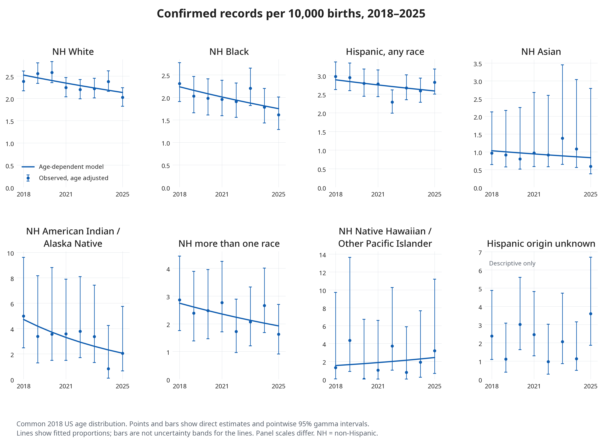
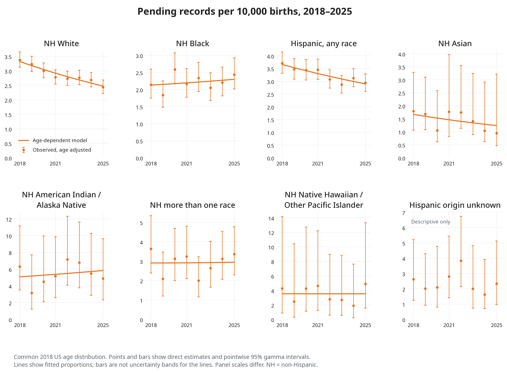
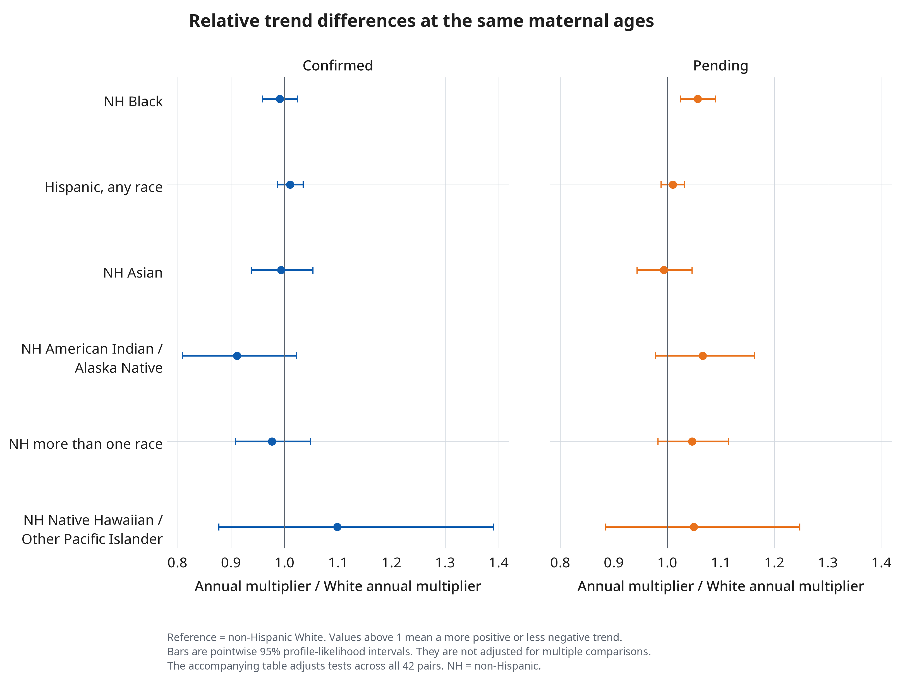

> [!NOTE]
> AI-assisted revision by Codex (GPT-6).

# Recorded Down syndrome trends by maternal age and race and ethnicity

Analysis dated 8 November 2026, covering births in 2018–2025.

The age-dependent model gives modest evidence that relative trends in **pending records differ by maternal race and ethnicity**. The adjusted p-value is 0.038. Confirmed records do not give clear evidence of such differences, with an adjusted p-value of 0.522. These findings concern certificate recording. They do not identify changes in true Down syndrome prevalence or explain why recording changed.

The pending comparison between non-Hispanic Black and non-Hispanic White mothers is the only group pair that passes the correction across all 42 comparisons. The model estimates a more positive pending trend for Black mothers at the same maternal ages. This result does not establish an increase at every age or in the group as a whole.

## Data and recorded status

The analysis uses 29,388,406 births occurring in the 50 states and District of Columbia. It includes births to foreign residents. The denominator for each proportion contains all births in that year, maternal age stratum and race and ethnicity group, including births with unknown Down syndrome status.

The source fields classify Down syndrome as confirmed, pending, absent or unknown. The [2018 NCHS user guide](https://ftp.cdc.gov/pub/Health_Statistics/NCHS/Dataset_Documentation/DVS/natality/UserGuide2018-508.pdf) describes confirmed and pending karyotype responses. We analyse those recorded responses separately. We have no follow-up showing whether a pending record later became confirmed. We have not independently verified either status against clinical records. The [2025 import audit](20261106-cdc-2025-import-audit.md) describes the later source file.

The analysis uses the raw `MRACEHISP` groups for this period. Hispanic mothers can be of any race. The other six named groups are non-Hispanic. Asian and Native Hawaiian or Other Pacific Islander mothers remain separate. Hispanic origin unknown or not stated is retained in descriptive results but excluded from the seven-group trend tests.

| Maternal group | Births in 2018–2025 | Confirmed records | Pending records |
| --- | ---: | ---: | ---: |
| Non-Hispanic White | 14,816,074 | 3,596 | 4,394 |
| Non-Hispanic Black | 4,083,728 | 831 | 915 |
| Non-Hispanic American Indian or Alaska Native | 208,200 | 58 | 100 |
| Non-Hispanic Asian | 1,800,214 | 228 | 290 |
| Non-Hispanic Native Hawaiian or Other Pacific Islander | 79,288 | 15 | 26 |
| Non-Hispanic more than one race | 703,561 | 147 | 194 |
| Hispanic, any race | 7,416,010 | 2,017 | 2,414 |
| Hispanic origin unknown or not stated | 281,331 | 86 | 83 |

The [aggregate counts](data/20261108-recorded-ds-trends/aggregate_counts.csv) retain every denominator and status count used in the analysis. National confirmed counts fell from 921 in 2018 to 834 in 2025. Pending counts fell from 1,187 to 963. The corresponding crude proportions fell from 2.423 to 2.304 and from 3.122 to 2.660 per 10,000 births. These crude changes do not adjust for maternal age. The [national table](data/20261108-recorded-ds-trends/national_counts_and_crude_proportions.csv) gives all eight years.

## Why the main model allows trends to vary with age

The earlier main model allowed a different annual trend in each maternal group but required that trend to be the same at every age within the group. The review reproduced its numerical results. It also found evidence against the common-age trend assumption for pending records.

Allowing seven age bands to have different trends improves the pending fit, with an adjusted p-value of 0.0109. The corresponding confirmed result is 0.0784. These values use 19,999 simulations for each test and a Holm correction across the two statuses. We use the age-dependent model for both statuses so that the analyses use the same structure. The confirmed result does not establish that its age trends are equal.

The updated model is fitted separately to confirmed and pending counts. It gives every combination of maternal group and detailed age stratum its own baseline recorded proportion. It then allows different relative trends in seven age bands, with an additional trend difference for each maternal group.

For group $r$, detailed age stratum $a$ and year $t$, the model is

$$
Y_{rat} \sim \operatorname{Poisson}(\mu_{rat}), \qquad
\log(\mu_{rat}) = \log(B_{rat}) + \alpha_{ra}
+ (t-2021.5)\{\beta_{b(a)}+\gamma_r\}.
$$

Here $Y$ is the number of records of the selected status, and $B$ is the number of births. The term $\alpha$ describes each group and age stratum's baseline. The term $\beta$ gives the trend for an age band. The term $\gamma$ gives a group's additional trend relative to non-Hispanic White mothers, whose reference value is zero. A log trend becomes an annual multiplier after exponentiation. For example, a multiplier of 0.96 means a 4% relative decline each year.

The detailed baseline strata are under 20, each single age from 20 to 44, and 45 or older. The trend bands are under 20, 20–24, 25–29, 30–34, 35–39, 40–44 and 45 or older. The model assumes that differences in log trends between maternal groups are the same across these bands. It therefore shares information across ages and groups. It does not estimate 49 unrelated trends.

## Age-adjusted proportions over time

For each group and year, we apply the same maternal age distribution, using all US occurrence births in 2018. This removes changes in the distribution across the 27 age strata from the comparisons. It does not fully control changes within the two pooled age tails.

Each plotted point is the weighted average of the observed age-specific proportions. Bars show pointwise 95% gamma intervals using the [Fay–Feuer method](https://wonder.cdc.gov/controller/pdf/FayFeuerConfidenceIntervals.pdf). This method allows for unequal weights and sparse counts under independent Poisson count assumptions. A zero observed count still has a positive upper limit.

The lines apply those same age weights to the fitted model proportions. The bars describe uncertainty in the direct observations, not uncertainty bands for the fitted lines. A fitted age stratum with no cases across all eight years has a zero baseline estimate. That boundary estimate does not establish that the underlying rate is zero. Uncertainty in trends is shown separately below.





The fitted pending curve declines for non-Hispanic White, non-Hispanic Asian and Hispanic mothers. It is flatter or rises in several other groups. For example, the fitted standardised change from 2018 to 2025 is -25.5% for White mothers and +7.9% for Black mothers. These are model point estimates using all eight years. They are not the observed endpoint changes or a test of an increase. The [fitted proportions](data/20261108-recorded-ds-trends/fitted_standardised_proportions.csv) and [endpoint summaries](data/20261108-recorded-ds-trends/fitted_endpoint_changes.csv) give the exact estimates.

With age-dependent trends, a group's standardised curve combines several age-specific curves. Its annual multiplier can therefore change over time. We no longer report one constant annual percentage change for each whole group.

## Differences between groups at the same ages

The main test asks whether the seven groups have equal annual relative changes at the same maternal ages, after allowing age bands to have different trends. It does not test whether whole-group standardised curves have identical percentage changes.

| Status | Test statistic | Simulated p-value | Holm-adjusted p-value |
| --- | ---: | ---: | ---: |
| Confirmed | 5.186 | 0.5216 | 0.5216 |
| Pending | 15.239 | 0.0192 | 0.0384 |

The test statistic measures how much the fit improves when group trend differences are allowed. Each test adds six parameters. For each simulation, we keep the observed births and the total case count in each group and age stratum fixed. We allocate those cases across years under the fitted model with no group trend differences, then refit both models. The p-value measures how often this procedure produces a fit improvement at least as large as the observed one. It is not the probability that the no-difference model is true.

The Holm adjustment accounts for testing both statuses. The pending simulated p-value has a Monte Carlo standard error of about 0.0010 before that adjustment. The [test table](data/20261108-recorded-ds-trends/global_tests.csv) records seeds, simulation counts and that numerical uncertainty.

For the pending Black–White comparison, the ratio of annual multipliers is **1.056**, with a pointwise 95% profile-likelihood interval of **1.024–1.090**. Thus, at a given age, the Black annual multiplier is about 5.6% larger than the White multiplier. This is a relative comparison, not a 5.6 percentage-point difference in recorded proportions.

Its adjusted p-value is 0.024 across all 21 pairs for each of the two statuses. No other pair passes that correction. For confirmed records, the Black–White ratio is 0.991, with an interval of 0.959–1.024. The [complete pairwise table](data/20261108-recorded-ds-trends/pairwise_trend_tests.csv) reports both statuses. Separate results for confirmed and pending do not themselves establish that the group differences are larger for one status; that would require a joint comparison.



The intervals retain parameter values whose fit is sufficiently close to the best fit, using the usual one-parameter likelihood cutoff. They are pointwise 95% intervals. They are not simultaneous intervals covering all comparisons. The adjusted p-values, rather than overlap between intervals, support the statements about multiple pairwise tests.

Age-specific changes also matter. For example, the White pending estimate is +1.6% per year at ages 20–24, with a 95% interval from -1.6% to +4.9%. At ages 30–34 it is -6.0%, with an interval from -8.1% to -4.0%. The [confirmed age-band figure](figures/20261108-recorded-ds-trends/confirmed_age_band_changes.png), [pending age-band figure](figures/20261108-recorded-ds-trends/pending_age_band_changes.png) and [interval table](data/20261108-recorded-ds-trends/age_band_trends_95ci.csv) show all groups. Those intervals are also pointwise and do not support unrestricted searches for individual age-band findings.

## Review and sensitivity checks

The revised fit reproduces the reviewed age-dependent tests and pairwise estimates. Fresh database aggregates match the reviewed counts. The [review reconciliation](data/20261108-recorded-ds-trends/review_reconciliation.json) records those checks. A separate implementation using [statsmodels generalised linear models](https://www.statsmodels.org/stable/generated/statsmodels.genmod.generalized_linear_model.GLM.html) reproduces the fitted slopes, fitted counts and covariance matrices. The [validation table](data/20261108-recorded-ds-trends/independent_glm_validation.csv) records the numerical differences. This checks the calculations under the model. It does not validate the recording assumptions.

The age-dependent sensitivity checks give the following results. These checks use approximate likelihood p-values, with a separate two-status Holm correction for each check. They are not additional independent discoveries.

| Check | Confirmed adjusted p-value | Pending adjusted p-value |
| --- | ---: | ---: |
| Binomial model of recorded proportions | 0.520 | 0.037 |
| Allow common unrestricted calendar-year changes | 0.527 | 0.039 |
| Restrict to individual ages 20–44 | 0.522 | 0.018 |
| Use seven age bands for baselines as well as trends | 0.541 | 0.032 |
| Omit 2018 | 0.664 | 0.066 |
| Omit 2019 | 0.428 | 0.428 |
| Omit 2025 | 0.798 | 0.388 |

The binomial check models odds rather than Poisson rate multipliers, so it is an approximation check with a slightly different target. The calendar check allows a shared departure from a straight log trend while retaining age-band and group trend terms. The [sensitivity table](data/20261108-recorded-ds-trends/sensitivity_tests.csv) contains every omitted-year result.

The pending Black–White annual multiplier ratio stays above one in all eight omitted-year fits, ranging from 1.043 to 1.067. Leaving out 2019 or 2025 reduces both the estimated contrast and the information available. Leaving out 2018 also moves the overall test above 0.05. Crossing that threshold does not establish a reversal or absence of an association. It does limit how firmly we can describe the evidence from this short period.

## Limits of the findings

The period and questions developed after inspection of these data. The review also used these data to choose the age-dependent model. The analysis is therefore exploratory. The stated multiple-testing adjustments do not account for all earlier choices of period, model or comparison.

These files contain registered births rather than a random sample of births. The intervals describe hypothetical variation in recorded counts under the specified model, conditional on fixed birth denominators and standard age weights. They do not quantify uncertainty from missed diagnoses, incorrect diagnoses, status changes after registration, imputed maternal characteristics or incomplete ascertainment. They also do not allow for dependence between births or shared changes in recording within places. The two status models are separate marginal models of mutually exclusive responses; the Holm procedure does not require the two tests to be independent.

Age adjustment does not control differences in geography, access to care, prenatal testing or recording practice. The microdata used here have no state identifier. Changes in maternal group composition may also remain within broad categories. The rising unknown-status count, from 6,107 in 2018 to 11,763 in 2025, is visible in the saved denominators but is not corrected by this model. We cannot assign those records to confirmed or pending cases.

Sparse counts limit conclusions for some groups. The Native Hawaiian or Other Pacific Islander group has only 15 confirmed and 26 pending records across all eight years. Large estimated percentage changes in that group have wide intervals. Lack of evidence for a difference, especially in these groups, does not establish equal trends.

The model still assumes a constant relative trend within each age band and a common pattern of group trend differences across bands. The calendar sensitivity relaxes one part of that structure. It does not establish that all age, group and year patterns are adequately represented. The results describe relative trends in recording. They do not estimate causal effects of maternal race or ethnicity, true prevalence, recording sensitivity or prenatal reduction.

## Reproduction and retained evidence

The main command is now [analyse_recorded_ds_trends.py](../scripts/analyse_recorded_ds_trends.py). It uses the reviewed age-dependent model and generates separate confirmed and pending figures. The likelihood calculations are in [recorded_trends.py](../src/dspopulations_us_birth_certificates/recorded_trends.py). The focused [tests](../tests/test_recorded_trends.py) check agreement with a full Poisson model, profile interval endpoints, standardisation and conditional simulations.

Run from the repository root:

```bash
uv run python scripts/analyse_recorded_ds_trends.py
```

The database is opened read-only. Each run writes a new directory under `output/recorded_ds_age_dependent/`. To reproduce the primary analysis and all listed sensitivity checks from the retained aggregate counts:

```bash
uv run python scripts/analyse_recorded_ds_trends.py \
  --counts-csv notes/data/20261108-recorded-ds-trends/aggregate_counts.csv
```

The [manifest](data/20261108-recorded-ds-trends/manifest.json) records code hashes, package versions, model definitions and output hashes. The database SHA-256 is `76c155a9c5ace6c7fcce4cb62bafa847e434d4f36aca1546432edcae353b8e01`. The retained counts and results are aggregates. They contain no record-level natality data. The figures are also saved as SVG files beside the PNG versions.

This note and these figures replace the constant-age trend model as the main analysis of the 2018–2025 race and ethnicity trends. Earlier local runs remain historical evidence of the review. Their single-slope estimates should not be substituted for the age-band estimates reported here.
