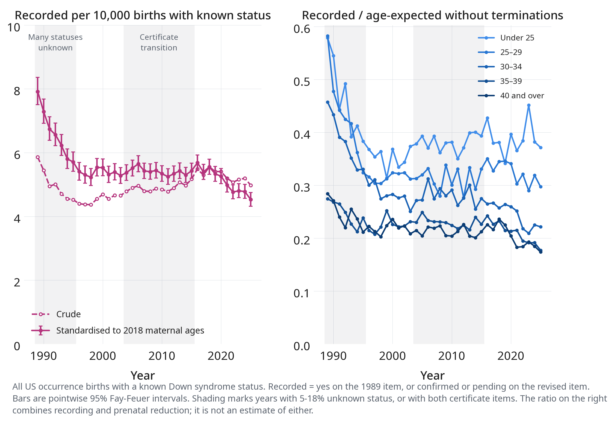
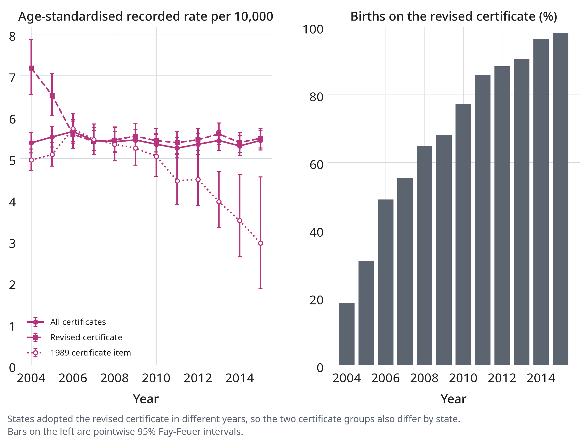
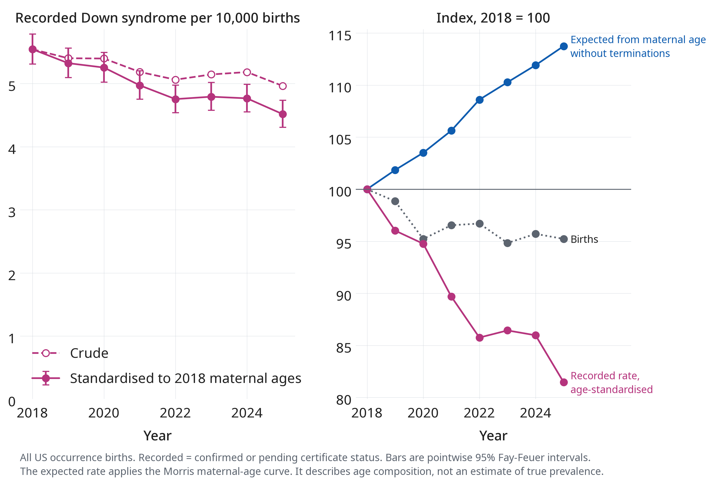
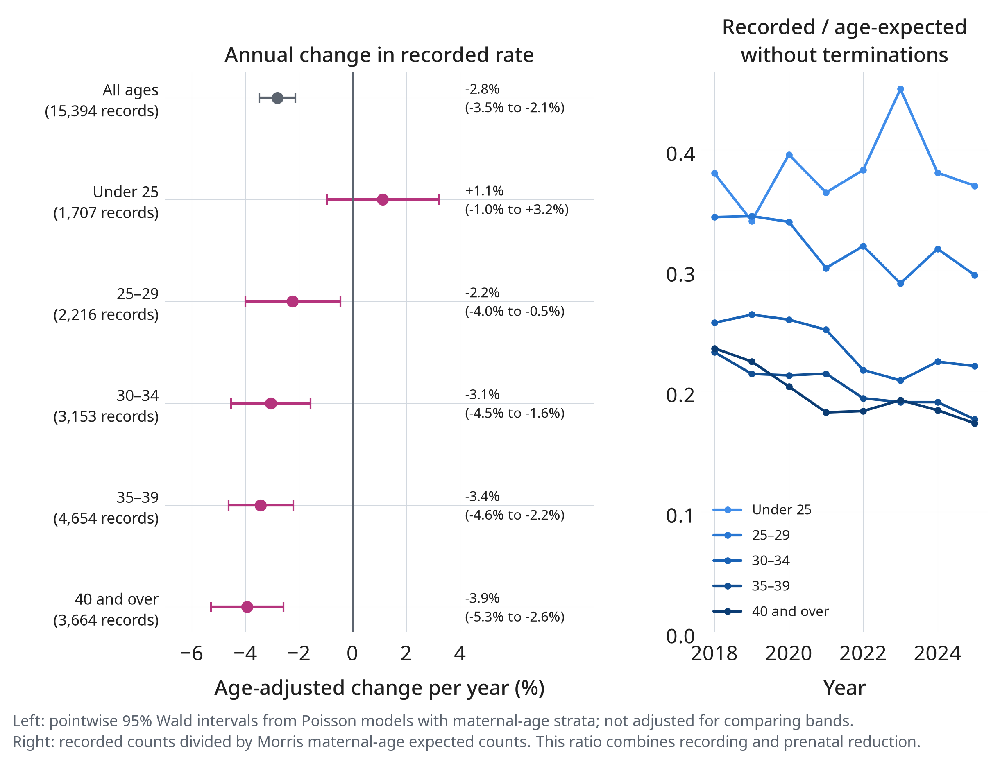

> [!NOTE]
> Drafted by Claude Code (Opus 5.5).

# National trends in recorded Down syndrome births

Analysis dated 25 November 2026, covering births in 1989–2025.

## Summary

After [adjusting for maternal age](#age-adjustment), the rate of births recorded with Down syndrome has had three phases:

- **1989–1995:** a fall of 5.9% a year, while many births still lacked a usable status.
- **1996–2015:** roughly flat, at 5.2 to 5.7 per 10,000 births.
- **2016–2025:** a fall of 2.5% a year. The 2025 rate, 4.53 per 10,000, is the lowest since 1989.

The two falls differ by maternal age. The early fall was steepest under age 30. The recent fall is steepest at 35 and over, with no fall under 25. From 2018 to 2025 alone, the rate fell 2.8% a year (95% interval 2.1% to 3.5%). Both confirmed and pending records fell.

These results describe certificate recording. They cannot show whether fewer babies with Down syndrome were born or fewer were recorded.

This note extends the [race and ethnicity analysis](20261108-recorded-ds-age-dependent-trends.md), which modelled confirmed and pending records separately for 2018–2025. Here we combine the two statuses at national level and go back to 1989.

## Data and methods

### Births and status

We use all 146,485,338 births occurring in the 50 states and District of Columbia in 1989–2025, including births to foreign residents. Of these, 142,438,807 have a known Down syndrome status and 70,312 are recorded with Down syndrome.

The certificate question changed. The 1989 certificate had a yes or no item. The 2003 revision asks whether Down syndrome is karyotype confirmed or pending, as the [2018 NCHS user guide](https://ftp.cdc.gov/pub/Health_Statistics/NCHS/Dataset_Documentation/DVS/natality/UserGuide2018-508.pdf) describes. States adopted the revision between 2003 and 2016.

The files for 2003–2015 code every birth on the 1989-style item. For births on the revised certificate, that code matched the revised status in every record of 2004–2015: yes for confirmed or pending, no for no, and 9 for unknown. So one item is comparable across 1989–2025: recorded, not recorded or unknown. It also agrees with the project's `down_ind` column in every record.

In 2003, 225,965 births (5.5%) were on the revised certificate, but the file gives them only the 1989-style item. We count them with that item. In the outputs, "revised" means that the revised item is present.

### Denominators

- **1989–2025:** births with a known status. Recorded means yes on the 1989 item, or confirmed or pending on the revised item.
- **2018–2025:** all births, as in the race and ethnicity analysis. Recorded means confirmed or pending.

The long-run denominator leaves out unknown status because it is common before 1996. In 1989, 17.6% of births have code 9, "not classifiable". Code 8, "not on certificate", appears in 1995 and 2000–2003. Counts this large suggest whole areas without the item, but our records have no state identifier.

### Age adjustment

The chance of a baby with Down syndrome rises steeply with maternal age, and mothers became older over the period. A crude rate can therefore change only because the mix of maternal ages changed. "Adjusting for maternal age" means removing that effect. This note does so in two ways:

- **Standardised rates.** A standardised rate is a weighted average of the recorded rates in each age group, with the weights fixed at the 2018 age distribution of all births. A change in mothers' ages therefore cannot change it. Recorded rates per 10,000 in this note are standardised unless they are called crude. Their 95% intervals use the [Fay–Feuer method](https://wonder.cdc.gov/controller/pdf/FayFeuerConfidenceIntervals.pdf).
- **Trends per year.** Each percentage change per year comes from a model that gives every age group its own baseline rate, described under [trend models](#trend-models). The trend therefore measures change within age groups, not change caused by a shift between them.

Both use 27 age groups: under 20, each age from 20 to 44, and 45 or older. Maternal age is the project's harmonised `mage_c` column. The top group absorbs changes in the top age code: 49 before 1997, 54 in 1997–2003 and 50 from 2004.

The expected rate applies the [Morris maternal-age curve](https://doi.org/10.1258/096914105775220679), the project's `p_ds_lb_nt`, to each birth. It shows what maternal age alone would do to the rate if no affected pregnancies were ended. It is not an estimate of true prevalence. Below, the "recorded-to-expected ratio" is recorded births divided by these expected births.

### Trend models

Each trend is a Poisson model of recorded counts by year and age group. Each age group has its own baseline, which is what adjusts the trend for maternal age. One log-linear year term gives the change, reported as a percentage per year with a 95% Wald interval. The model assumes the same relative change in every age group. The age-band fits below relax that. We also report:

- an interval widened by the Pearson dispersion, where that exceeds 1;
- a likelihood-ratio test of the straight line against a separate level for each year, where a low p-value would suggest a break or curve;
- separate fits for five maternal-age bands, and an approximate test that their trends are equal.

All intervals are pointwise. None is adjusted for multiple comparisons.

## Long-run trend, 1989–2025

| Year | Unknown status | Mean maternal age | Standardised rate per 10,000 (95% interval) | Recorded-to-expected ratio |
| --- | ---: | ---: | ---: | ---: |
| 1989 | 17.6% | 26.3 | 7.92 (7.50 to 8.37) | 0.439 |
| 1996 | 2.1% | 26.9 | 5.41 (5.13 to 5.69) | 0.273 |
| 2003 | 1.3% | 27.4 | 5.28 (5.04 to 5.53) | 0.259 |
| 2015 | 0.15% | 28.5 | 5.43 (5.20 to 5.67) | 0.262 |
| 2016 | 0.17% | 28.7 | 5.68 (5.45 to 5.93) | 0.272 |
| 2025 | 0.32% | 29.8 | 4.53 (4.32 to 4.75) | 0.207 |

From 1996 to 2015, the standardised rate stayed between 5.23 (1998) and 5.65 (2006). The recorded-to-expected ratio stayed between 0.255 and 0.277. Over the whole period, births to mothers aged 35 or older rose from 8.4% to 22.0%. The expected rate rose from 13.3 to 24.0 per 10,000, so the crude rate fell much less than the standardised rate.



### Trends within periods

We set the periods by certificate design and unknown-status share, not by the shape of the trend.

| Period | Why it is separate | Records | Change per year | 95% interval | Straight-line test, p |
| --- | --- | ---: | ---: | ---: | ---: |
| 1989–1995 | 1989 item; 5–18% unknown | 12,653 | -5.9% | -6.7% to -5.0% | 0.18 |
| 1996–2003 | 1989 item; under 3% unknown | 14,177 | -0.1% | -0.9% to +0.6% | 0.74 |
| 2004–2015 | Both items, by state | 23,876 | -0.2% | -0.6% to +0.2% | 0.81 |
| 2016–2025 | Revised item in every state | 19,606 | -2.5% | -2.9% to -2.0% | 0.54 |

No period departs clearly from a straight line. For all ages, the Pearson dispersion was 0.98 to 1.21, so the widened intervals barely differ. A fall starting in 2016 and one starting in 2018 both fit the latest period. Because 2016 was a high year, the data cannot show when the decline began.

### Age patterns by period

| Maternal age | 1989–1995 | 1996–2003 | 2004–2015 | 2016–2025 |
| --- | ---: | ---: | ---: | ---: |
| Under 25 | -6.8% | -0.1% | +0.3% | -0.1% |
| 25–29 | -8.2% | +0.5% | 0.0% | -1.7% |
| 30–34 | -5.7% | -2.1% | -0.4% | -2.6% |
| 35–39 | -3.5% | +0.9% | -0.5% | -3.1% |
| 40 and over | -3.8% | 0.0% | -0.2% | -3.1% |
| Equal-trend test, approximate p | 0.004 | 0.063 | 0.74 | 0.002 |

The two falls have opposite age patterns. From 1989 to 1996, the recorded-to-expected ratio fell from 0.58 to 0.37 under 25, but only from 0.28 to 0.22 at 40 and over. Since 2016, the fall has been at ages 25 and over and steepest from 35.

### The certificate transition

From 2004 to 2015, the share of births with the revised item rose from 18.5% to 98.3%. The national rate stayed flat, but the two groups moved apart. The revised group started at 7.18 per 10,000 in 2004. The group still on the 1989 item fell to 2.95 by 2015. At the same year and age, the revised group's rate was about equal to the other group's in 2006–2008, but 1.84 times it in 2015.

One constant ratio does not fit these years (likelihood ratio 74.9 on 11 degrees of freedom, p < 0.001). The groups differ by state as well as by certificate, and their states change every year. A changing mix of states would produce this pattern, so the gap cannot show what the revision itself did. A model that forces one ratio (1.13) gives a trend of -1.0% a year. We do not rely on it. The national rate shows no clear step when the revision was completed: 5.43 in 2015, 5.68 in 2016 and 5.39 in 2017.



### Outside evidence

The project's [surveillance workbook audit](20260803-degraaf-surveillance-workbook-extraction.md) compared recorded births with surveillance-based estimates of live births with Down syndrome. In 15 five-year windows centred on 2000 to 2014, recorded births averaged 0.379 of the estimate, with a standard deviation of 0.005. Windows centred on 2016 and 2018 gave 0.402. This agrees with the flat recorded rate before 2016. It does not prove that recording completeness was constant, because it depends on the workbook's programmes and assumptions. The windows end in 2020, before most of the recent fall.

## Recent trend, 2018–2025

This section uses all 29,388,406 births in 2018–2025 as the denominator.

| Measure | 2018 | 2025 | Change |
| --- | ---: | ---: | ---: |
| Births | 3,801,534 | 3,619,990 | -4.8% |
| Recorded Down syndrome births | 2,108 | 1,797 | -14.8% |
| Crude rate per 10,000 births | 5.55 | 4.96 | -10.5% |
| Standardised rate per 10,000 births | 5.55 | 4.52 | -18.5% |
| Expected rate per 10,000 births | 21.1 | 24.0 | +13.7% |
| Recorded-to-expected ratio | 0.263 | 0.207 | -21.3% |

Births to mothers aged 35 or older rose from 18.3% to 22.0%, so the crude rate understates the fall. The 2025 standardised rate is 4.52 per 10,000 (4.31 to 4.73). The long-run series gives 4.53, because it leaves out births of unknown status.



### Trend by status

| Status | Records | Change per year | 95% interval | Widened interval | Straight-line test, p |
| --- | ---: | ---: | ---: | ---: | ---: |
| Confirmed | 6,978 | -2.3% | -3.3% to -1.3% | -3.4% to -1.3% | 0.45 |
| Pending | 8,416 | -3.2% | -4.1% to -2.3% | -4.2% to -2.2% | 0.90 |
| Combined | 15,394 | -2.8% | -3.5% to -2.1% | -3.5% to -2.1% | 0.69 |

The Pearson dispersion for combined records was 1.13. No status departs from a straight line, including in 2020 and 2021. Pending records were 53% to 56% of the total every year, so the fall is not a shift between statuses. We cannot tell whether pending records were later confirmed.

### Trend by maternal age

| Maternal age | Records | Change per year | 95% interval | Recorded-to-expected ratio, 2018 | Ratio, 2025 |
| --- | ---: | ---: | ---: | ---: | ---: |
| Under 25 | 1,707 | +1.1% | -1.0% to +3.2% | 0.381 | 0.370 |
| 25–29 | 2,216 | -2.2% | -4.0% to -0.5% | 0.344 | 0.296 |
| 30–34 | 3,153 | -3.1% | -4.5% to -1.6% | 0.257 | 0.221 |
| 35–39 | 4,654 | -3.4% | -4.6% to -2.2% | 0.232 | 0.177 |
| 40 and over | 3,664 | -3.9% | -5.3% to -2.6% | 0.236 | 0.173 |

The band trends differ (likelihood ratio 18.2 on 4 degrees of freedom, approximate p = 0.001). The race and ethnicity analysis found similar evidence for pending records (adjusted p = 0.011), and weaker evidence for confirmed records (0.078). At 40 and over, the crude rate fell from 39.2 to 28.9 per 10,000. The under-25 band is small and noisy, and its interval does not rule out a small fall.



### Unknown status

Births with unknown status rose from 6,107 (16.1 per 10,000) in 2018 to 11,763 (32.5 per 10,000) in 2025. To test their effect, we gave them recorded cases at a multiple of the known-status rate in the same year and age group.

| Multiple of known-status rate | Cases added, 2018 | Cases added, 2025 | Change per year | 95% interval |
| ---: | ---: | ---: | ---: | ---: |
| 1 | 3.5 | 5.9 | -2.8% | -3.5% to -2.1% |
| 5 | 17.5 | 29.3 | -2.7% | -3.4% to -2.0% |
| 10 | 35.1 | 58.6 | -2.6% | -3.2% to -1.9% |

Even at ten times the known-status rate, they explain little of the fall. A multiple of 1 gives the same rates as the long-run denominator.

### Outside sources

[CDC WONDER](https://wonder.cdc.gov/natality-expanded-current.html) counts for resident births agree with these occurrence counts: 2,106 against 2,108 in 2018, and 1,883 against 1,886 in 2024. Births to foreign residents account exactly for the differences, in both recorded and total births.

The [CDC and NBDPN national estimates](https://www.cdc.gov/birth-defects/media/pdfs/2026/04/Data-Brief-Birth-Defects-National-Estimates-2018-2022.pdf) give trisomy 21 prevalence of 16.4, 16.5, 16.1, 16.3 and 15.3 per 10,000 live births for 2018–2022. They count all pregnancy outcomes, come from 11 surveillance programmes and are not age adjusted. The certificate rate stays between 0.32 and 0.34 of the NBDPN rate, with no consistent direction. Both fell from 2018 to 2022, NBDPN mostly in 2022. This does not show whether total prevalence changed.

## Limits

The recorded-to-expected ratio combines two unknowns. One is the share of affected live births that are recorded. The other is the share of affected pregnancies that did not end in a live birth, which the project calls prenatal reduction. A fall in either lowers the ratio. Neither has an independent yearly estimate for recent years. The project's reduction series is extrapolated from 2019 or 2020, and its derivation is unresolved. There are no recording weights or reduction values for 2025, as the [2025 reference review](20261106-2025-reference-review-and-classifiers.md) records.

The recent fall, steepest at older ages, fits a rise in prenatal diagnosis and ended pregnancies that is larger at older ages. Recording could also have changed differently by age. The data cannot tell these apart.

The early fall happened while the share of births with unknown status fell from 17.6% to 7.1%. If the births that gained a status had lower recorded rates, the national rate would fall with no change in recording. The data cannot show how much of the early fall reflects reporting coverage, recording, diagnosis or prenatal reduction.

Without a state identifier, we cannot see which areas lacked the item before 1996, which states used each certificate in 2004–2015, or whether a few states drive the recent fall.

The intervals reflect count variation under the models, with births held fixed. They leave out diagnostic error, status changes after registration, imputed maternal age and clustering within states. We planned the analysis after inspecting these data, so it is exploratory.

## Reproduction and outputs

Run from the repository root:

```bash
uv run python scripts/analyse_national_recorded_ds_trend.py
```

The script, [analyse_national_recorded_ds_trend.py](../scripts/analyse_national_recorded_ds_trend.py), opens the database read-only and writes a new directory under `output/recorded_ds_national_trend/`. It checks that each period holds only the certificate items its label states. In database mode, it also checks its status classes against `down_ind`, its ages against `mager` and the stored `p_ds_lb_nt` values against the Morris formula. It reuses [recorded_trends.py](../src/dspopulations_us_birth_certificates/recorded_trends.py) for Fay–Feuer intervals and [chance.py](../src/dspopulations_us_birth_certificates/chance.py) for the Morris curve. Its [tests](../tests/test_analyse_national_recorded_ds_trend.py) include a complete run from saved counts.

To reproduce every table and figure from the retained counts:

```bash
uv run python scripts/analyse_national_recorded_ds_trend.py \
  --counts-csv notes/data/20261125-national-recorded-ds-trend/year_age_certificate_counts.csv
```

That command reproduced every retained table exactly. The retained outputs are aggregates and contain no record-level data.

| File | Contents |
| --- | --- |
| [year_age_certificate_counts.csv](data/20261125-national-recorded-ds-trend/year_age_certificate_counts.csv) | Input counts by year, single year of maternal age and certificate item |
| [long_run_summary.csv](data/20261125-national-recorded-ds-trend/long_run_summary.csv) | Yearly births, unknown share, rates and recorded-to-expected ratio, 1989–2025 |
| [long_run_standardised_rates_95ci.csv](data/20261125-national-recorded-ds-trend/long_run_standardised_rates_95ci.csv) | Standardised rates, overall and by certificate item |
| [long_run_period_trends.csv](data/20261125-national-recorded-ds-trend/long_run_period_trends.csv) | Period trends, for all ages and by band |
| [long_run_period_band_tests.csv](data/20261125-national-recorded-ds-trend/long_run_period_band_tests.csv) | Equal-trend tests by period |
| [long_run_age_band_rates.csv](data/20261125-national-recorded-ds-trend/long_run_age_band_rates.csv) | Yearly rates and ratios by band, 1989–2025 |
| [certificate_gap_by_year.csv](data/20261125-national-recorded-ds-trend/certificate_gap_by_year.csv) and [certificate_gap_test.csv](data/20261125-national-recorded-ds-trend/certificate_gap_test.csv) | Certificate gap by year and the constant-gap test |
| [national_summary.csv](data/20261125-national-recorded-ds-trend/national_summary.csv) | Yearly counts and rates, 2018–2025 |
| [standardised_rates_95ci.csv](data/20261125-national-recorded-ds-trend/standardised_rates_95ci.csv) | Standardised rates by status, 2018–2025 |
| [age_adjusted_trends.csv](data/20261125-national-recorded-ds-trend/age_adjusted_trends.csv) and [age_adjusted_year_ratios.csv](data/20261125-national-recorded-ds-trend/age_adjusted_year_ratios.csv) | Trends by status and band, and yearly rate ratios, 2018–2025 |
| [age_band_rates.csv](data/20261125-national-recorded-ds-trend/age_band_rates.csv) and [age_band_slope_test.csv](data/20261125-national-recorded-ds-trend/age_band_slope_test.csv) | Band rates and the equal-trend test, 2018–2025 |
| [unknown_status_sensitivity.csv](data/20261125-national-recorded-ds-trend/unknown_status_sensitivity.csv) | Unknown-status sensitivity |
| [external_comparison.csv](data/20261125-national-recorded-ds-trend/external_comparison.csv) | CDC WONDER and NBDPN comparison |
| [age_weights.csv](data/20261125-national-recorded-ds-trend/age_weights.csv) | 2018 standard age weights |

The [manifest](data/20261125-national-recorded-ds-trend/manifest.json) records code hashes, package versions, model definitions and output hashes. The database SHA-256 is `76c155a9c5ace6c7fcce4cb62bafa847e434d4f36aca1546432edcae353b8e01`. The figures are also saved as SVG files beside the PNG versions.
